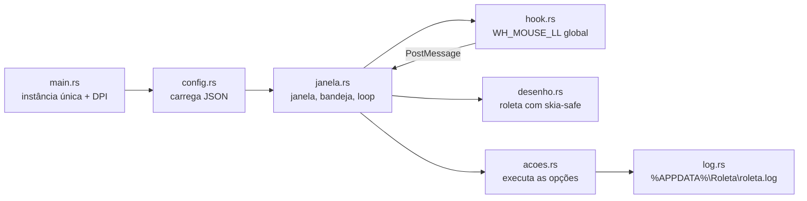

# 🎯 Roleta

[](https://www.rust-lang.org/pt-BR)
[](https://github.com/1155dosilicon/roleta-rs)
[](LICENSE)

Menu radial (roleta de opções) para Windows, acionado pelo **botão lateral do mouse**. Segure o botão, aponte na direção da opção desejada e solte para executar. Escrito 100% em Rust, num único executável.

> Parecido com o [pie menu](https://en.wikipedia.org/wiki/Pie_menu) de softwares como o CAD ou o *Radial Menu* do StrokesPlus — mas sem dependências, sem runtime, nativo.

## ✨ Funcionalidades

- **Menu radial em volta do cursor** — abre onde o mouse está, sem precisar mirar numa barra de menu
- **Dois modos de uso**:
  - **Segurar e soltar**: mantenha o botão lateral pressionado, arraste na direção da opção e solte
  - **Clique fixo**: um clique rápido abre a roleta fixa; escolha com o botão esquerdo, cancele com o direito
- **5 tipos de ação**: `abrir` (arquivo, pasta, site, URI ou programa), `comando`, `teclas` (atalhos de teclado), `texto` (digitação) e `sair`
- **Aparência autoral**: fatias em degradê, ícones SVG embutidos, glifos da fonte [Segoe Fluent Icons](https://learn.microsoft.com/pt-br/windows/apps/design/style/segoe-fluent-icons-font) e suporte a SVG próprio
- **Funciona sobre janelas elevadas**: o hook do mouse é global e o processo roda com privilégio de administrador, então a roleta abre até sobre o Gerenciador de Tarefas
- **Programas abertos rodam como usuário normal**: quando a roleta está elevada, os processos que ela lança são re-paiados para o Explorer, sem herdar permissões de admin (segurança)
- **Ícone na bandeja** com menu para configurar, pré-visualizar e sair
- **Instância única**: não abre duas roletas ao mesmo tempo (mutex)
- **Zero dependências em runtime**: um único `.exe` (~2 MB), sem .NET, sem Python, sem instalador de terceiros
- **Log de erros** em `%APPDATA%\Roleta\roleta.log`

## ⚙️ Requisitos

- Windows 10/11
- [Rust](https://www.rust-lang.org/tools/install) (para compilar)
- PowerShell 5.1+ (já vem no Windows)

## 🚀 Instalação

```powershell
git clone https://github.com/1155dosilicon/roleta-rs.git
cd roleta-rs
powershell -ExecutionPolicy Bypass -File instalar.ps1
```

O script:

1. Compila `Roleta.exe` com `cargo build --release`
2. Pede permissão de administrador (UAC) **uma vez** e:
   - instala em `C:\Program Files\Roleta` (um único arquivo)
   - cria a tarefa agendada `Roleta`, que inicia no logon com privilégio elevado (sem UAC), garantindo que o hook funcione até em janelas de administrador
   - verifica que os programas abertos pela roleta rodam como usuário normal
   - inicia a roleta
3. Cria o atalho "Roleta" no Menu Iniciar

Desinstalar:

```powershell
powershell -ExecutionPolicy Bypass -File instalar.ps1 -Desinstalar
```

## 🧭 Como usar

| Ação | Resultado |
|------|-----------|
| **Segurar** o botão lateral | A roleta aparece em volta do cursor |
| Mover o mouse na direção de uma opção e **soltar** | Executa a opção |
| Soltar no centro ou fora da roleta | Cancela |
| **Clique rápido** no botão lateral | A roleta fica aberta; escolha com o botão esquerdo |
| Botão direito (roleta aberta) | Cancela |
| Clique no ícone da bandeja | Menu: Configurar, Prévia, Sair |

## 📝 Configuração

O arquivo `%APPDATA%\Roleta\roleta_config.json` é criado na primeira execução. Exemplo:

```json
{
  "botao": "x1",
  "raio": 130,
  "opcoes": [
    {
      "nome": "Pasta proj",
      "icone": "pasta",
      "tipo": "abrir",
      "valor": "C:\\Users\\voce\\proj"
    },
    {
      "nome": "Print",
      "icone": "print",
      "tipo": "abrir",
      "valor": "ms-screenclip:"
    },
    {
      "nome": "Terminal",
      "icone": "terminal",
      "tipo": "comando",
      "valor": "wt -d \"C:\\Users\\voce\\proj\""
    },
    {
      "nome": "Mute",
      "icone": "E799",
      "tipo": "teclas",
      "valor": "<win>+<m>"
    },
    {
      "nome": "Saudação",
      "tipo": "texto",
      "valor": "Bom dia!"
    },
    {
      "nome": "Fechar",
      "tipo": "sair"
    }
  ]
}
```

### Campos

| Campo | Descrição | Padrão |
|-------|-----------|--------|
| `botao` | Botão que abre a roleta: `"x1"` (voltar), `"x2"` (avançar) ou `"ambos"` | `"x1"` |
| `raio` | Raio da roleta em pixels (60–400) | `130` |
| `opcoes` | Lista de opções da roleta | 5 opções de exemplo |
| `nome` | Rótulo exibido na fatia | `"?"` |
| `icone` | Ícone: nome embutido (`"pasta"`, `"print"`, `"terminal"`, `"chrome"`, `"tarefas"`), caminho de um `.svg` (relativo à pasta de dados) ou código hexadecimal do glifo da Segoe Fluent Icons | vazio |
| `tipo` | `abrir`, `comando`, `teclas`, `texto` ou `sair` | vazio |
| `valor` | Depende do tipo — ver abaixo | vazio |

### Tipos de ação (`tipo` / `valor`)

| `tipo` | `valor` | O que faz |
|--------|---------|-----------|
| `abrir` | Caminho de arquivo/pasta, executável no `PATH`, site (`https://...`) ou URI (`ms-screenclip:`) | Abre com o padrão do Windows |
| `comando` | Linha de comando (ex.: `wt -d "C:\proj"`) | Roda via `cmd /c`, sem janela |
| `teclas` | Atalho no formato `<ctrl>+<shift>+s`, `<win>+<m>`, `f5`, `media_play_pause`... | Envia as teclas (pressiona e solta em ordem) |
| `texto` | Texto qualquer | Digita como teclado Unicode |
| `sair` | (ignorado) | Encerra a roleta |

### Testar sem instalar

```powershell
$env:ROLETA_CONFIG = "C:\caminho\outra_config.json"   # outra config
cargo run -- --teste                                   # roda ao lado da instalada
cargo run -- --previa "$env:TEMP"                      # gera PNGs do visual e sai
```

## 🏗️ Arquitetura



| Módulo | Responsabilidade |
|--------|------------------|
| `src/main.rs` | Ponto de entrada: mutex de instância única, DPI, argumentos (`--teste`, `--previa`, `--teste-usuario`) |
| `src/config.rs` | Carrega/salva `roleta_config.json` (serde), cria o padrão na 1ª execução |
| `src/hook.rs` | Hook global de mouse (`WH_MOUSE_LL`) em thread de alta prioridade; engole o botão lateral para o navegador não disparar "voltar/avançar" |
| `src/janela.rs` | Janela transparente, renderização em `DIB`, bandeja, menu de contexto, animação da roleta |
| `src/desenho.rs` | Desenha a roleta: fatias em degradê, arcos, ícones SVG via `resvg`, quebra de texto |
| `src/acoes.rs` | Executa opções: `abrir`/`comando` com re-paiamento para o Explorer (anti-elevação), `teclas`/`texto` via `SendInput` |
| `src/log.rs` | Log simples em `%APPDATA%\Roleta\roleta.log` |

**Segurança**: a roleta roda como administrador para o hook funcionar em janelas elevadas, mas ao abrir um programa ela cria o processo tendo o **Explorer como pai** (que roda como usuário normal), para que o Chrome, o terminal etc. **não** herdem privilégios de admin.

**Animação**: o hook roda em thread `THREAD_PRIORITY_HIGHEST` para o mouse não "engasgar"; a roleta anima por tick de timer (veja `janela.rs::tick`).

## 🛠️ Desenvolvimento

```powershell
cargo build          # compila (otimiza dependências mesmo em debug)
cargo run            # roda direto, sem instalar
cargo build --release
```

- `build.rs` e `winresource` embutem o ícone `.ico` e o manifesto no `.exe`
- `examples/gerar_icone.rs` regenera os ícones a partir dos SVGs em `assets/`
- Pré-visualização de telas: `cargo run -- --previa pasta`

## 📂 Estrutura

```
roleta-rs/
├── assets/            # SVGs dos ícones embutidos + ícone do .exe
├── examples/
│   └── gerar_icone.rs # gera o .ico a partir dos SVGs
├── src/
│   ├── acoes.rs       # ações das opções (abrir, comando, teclas, texto)
│   ├── config.rs      # carregamento da configuração JSON
│   ├── desenho.rs     # desenho da roleta (skia-safe)
│   ├── hook.rs        # hook global do mouse
│   ├── janela.rs      # janela, bandeja e loop de eventos
│   ├── log.rs         # log de erros
│   └── main.rs        # entrada, instância única, DPI
├── build.rs           # embute ícone/manifesto no .exe
├── Cargo.toml
└── instalar.ps1       # instala/desinstala (compila + UAC + tarefa agendada)
```

## 🤝 Contribuindo

1. Faça um fork
2. Crie uma branch (`git checkout -b feature/minha-feature`)
3. Commit (`git commit -m 'feat: minha feature'`)
4. Push (`git push origin feature/minha-feature`)
5. Abra um Pull Request

## 📄 Licença

Distribuído sob a licença BSD 3-Clause — veja [LICENSE](LICENSE).
