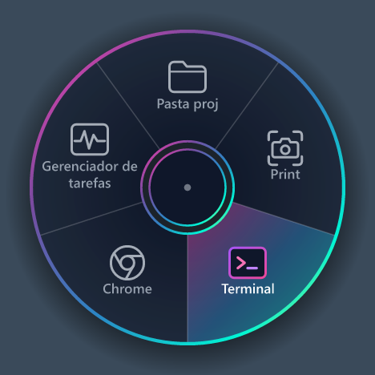
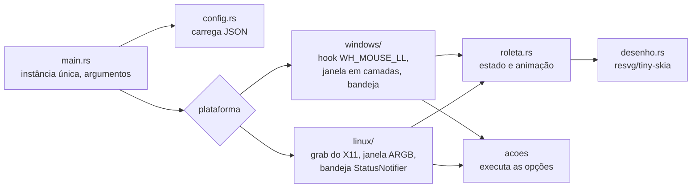

# 🎯 Roleta

[](https://www.rust-lang.org/pt-BR)
[-blue)](https://github.com/1155dosilicon/roleta-rs)
[](LICENSE)

Menu radial (roleta de opções) para **Windows** e **Linux (X11)**, acionado pelo **botão lateral do mouse**. Segure o botão, aponte na direção da opção desejada e solte para executar. Escrito 100% em Rust, num único executável.

<p align="center"></p>

> Parecido com o [pie menu](https://en.wikipedia.org/wiki/Pie_menu) de softwares como o CAD ou o *Radial Menu* do StrokesPlus — mas sem dependências, sem runtime, nativo.

## ✨ Funcionalidades

- **Menu radial em volta do cursor** — abre onde o mouse está, sem precisar mirar numa barra de menu
- **Dois modos de uso**:
  - **Segurar e soltar**: mantenha o botão lateral pressionado, arraste na direção da opção e solte
  - **Clique fixo**: um clique rápido abre a roleta fixa; escolha com o botão esquerdo, cancele com o direito
- **5 tipos de ação**: `abrir` (arquivo, pasta, site, URI ou programa), `comando`, `teclas` (atalhos de teclado), `texto` (digitação) e `sair`
- **Aparência própria**: fatias em degradê, ícones SVG embutidos, glifos da fonte [Segoe Fluent Icons](https://learn.microsoft.com/pt-br/windows/apps/design/style/segoe-fluent-icons-font) (Windows) ou de uma [Nerd Font](https://www.nerdfonts.com/) (Linux) e suporte a SVG próprio
- **Funciona sobre janelas elevadas** (Windows): o hook do mouse é global e o processo roda com privilégio de administrador, então a roleta abre até sobre o Gerenciador de Tarefas
- **Programas abertos rodam como usuário normal** (Windows): quando a roleta está elevada, os processos que ela lança são re-paiados para o Explorer, sem herdar permissões de admin (segurança)
- **Ícone na bandeja** com menu para editar as opções, reiniciar (aplica as mudanças) e sair
- **Instância única**: não abre duas roletas ao mesmo tempo (mutex no Windows, `flock` no Linux)
- **Zero dependências em runtime**: um único executável (~3 MB no Windows, ~5 MB no Linux), sem .NET, sem Python, sem instalador de terceiros; no Linux fala direto com o X11, sem libX11/GTK
- **Log de erros** em `%APPDATA%\Roleta\roleta.log` (Windows) ou `~/.local/state/roleta/roleta.log` (Linux)

## ⚙️ Requisitos

- **Windows** 10/11 com PowerShell 5.1+ (já vem no Windows)
- **Linux** com sessão **X11** (XFCE, MATE, Cinnamon, KDE no X11...) e um compositor ligado, para a transparência (o do xfwm4 já vem ligado). Wayland não é suportado: lá um programa não pode capturar o botão do mouse globalmente
- [Rust](https://www.rust-lang.org/tools/install) (para compilar)

## 🚀 Instalação

### Windows

**Só quer usar?** Baixe o `Roleta.exe` na [página de releases](https://github.com/1155dosilicon/roleta-rs/releases/latest) e abra. Assim ele roda como usuário normal, então não aparece sobre janelas de administrador nem inicia com o Windows. Para isso, use o instalador:

```powershell
git clone https://github.com/1155dosilicon/roleta-rs.git
cd roleta-rs
powershell -ExecutionPolicy Bypass -File instalar.ps1
```

O script:

1. Compila `Roleta.exe` com `cargo build --release`
2. Pede permissão de administrador (UAC) **uma vez** e:
   - instala em `C:\Program Files\Roleta` (um único arquivo)
   - cria a tarefa agendada `Roleta`, que inicia no logon com privilégio elevado (sem UAC), garantindo que o hook funcione até em janelas de administrador
   - verifica que os programas abertos pela roleta rodam como usuário normal
   - inicia a roleta
3. Cria o atalho "Roleta" no Menu Iniciar

Desinstalar:

```powershell
powershell -ExecutionPolicy Bypass -File instalar.ps1 -Desinstalar
```

### Linux (X11)

**Só quer usar?** Baixe o `roleta-<versão>-linux-x86_64.tar.gz` na [página de releases](https://github.com/1155dosilicon/roleta-rs/releases/latest) (binário estático, funciona em qualquer distro x86_64) e instale sem precisar do Rust:

```sh
tar xzf roleta-*-linux-x86_64.tar.gz
cd roleta-*-linux-x86_64
sh instalar.sh
```

Ou compile a partir do código:

```sh
git clone https://github.com/1155dosilicon/roleta-rs.git
cd roleta-rs
sh instalar.sh
```

O script compila com `cargo build --release` (ou usa o binário pronto do pacote), instala em `~/.local/bin/roleta` (sem root), põe o início automático em `~/.config/autostart/roleta.desktop` e o atalho "Roleta" no menu de aplicativos, e inicia a roleta. Desinstalar: `sh instalar.sh --desinstalar`.

No Linux não existe a questão do administrador: o grab do X11 funciona em cima de qualquer janela. Os programas abertos pela roleta rodam soltos dela (grupo de processos próprio) e, se falharem, o erro vai para o log.

## 🧭 Como usar

| Ação | Resultado |
|------|-----------|
| **Segurar** o botão lateral | A roleta aparece em volta do cursor |
| Mover o mouse na direção de uma opção e **soltar** | Executa a opção |
| Soltar no centro ou fora da roleta | Cancela |
| **Clique rápido** no botão lateral | A roleta fica aberta; escolha com o botão esquerdo |
| Botão direito (roleta aberta) | Cancela |
| Clique no ícone da bandeja | Menu: Editar opções, Reiniciar, Sair |

## 📝 Configuração

O arquivo `roleta_config.json` é criado na primeira execução em `%APPDATA%\Roleta\` (Windows) ou `~/.config/roleta/` (Linux). Exemplo do Windows:

```json
{
  "botao": "x1",
  "raio": 130,
  "opcoes": [
    {
      "nome": "Pasta proj",
      "icone": "pasta",
      "tipo": "abrir",
      "valor": "C:\\Users\\voce\\proj"
    },
    {
      "nome": "Print",
      "icone": "print",
      "tipo": "abrir",
      "valor": "ms-screenclip:"
    },
    {
      "nome": "Terminal",
      "icone": "terminal",
      "tipo": "comando",
      "valor": "wt -d \"C:\\Users\\voce\\proj\""
    },
    {
      "nome": "Mute",
      "icone": "E799",
      "tipo": "teclas",
      "valor": "<win>+<m>"
    },
    {
      "nome": "Saudação",
      "tipo": "texto",
      "valor": "Bom dia!"
    },
    {
      "nome": "Fechar",
      "tipo": "sair"
    }
  ]
}
```

No Linux as opções padrão são as mesmas, com os programas de lá:

```json
{
  "botao": "x1",
  "raio": 130,
  "opcoes": [
    { "nome": "Pasta ai", "icone": "pasta",    "tipo": "comando", "valor": "mkdir -p ~/ai && thunar ~/ai" },
    { "nome": "Print",    "icone": "print",    "tipo": "comando", "valor": "xfce4-screenshooter -r" },
    { "nome": "Claude",   "icone": "terminal", "tipo": "comando",
      "valor": "mkdir -p ~/ai && kitty --directory ~/ai sh -c 'command -v claude >/dev/null && claude; exec \"${SHELL:-bash}\"'" },
    { "nome": "Chrome",   "icone": "chrome",   "tipo": "abrir",   "valor": "google-chrome" },
    { "nome": "Gerenciador de tarefas", "icone": "tarefas", "tipo": "comando", "valor": "kitty -e aerotop" }
  ]
}
```

O "Claude" abre o terminal na pasta `~/ai` já rodando o [Claude Code](https://claude.com/claude-code) (se estiver instalado) e volta para o shell quando ele termina. A roleta põe `~/.local/bin`, `~/.cargo/bin` e `~/.bun/bin` no `PATH` dos comandos, porque a sessão gráfica costuma não ter.

### Campos

| Campo | Descrição | Padrão |
|-------|-----------|--------|
| `botao` | Botão que abre a roleta: `"x1"` (voltar; botão 8 no X11), `"x2"` (avançar; botão 9) ou `"ambos"` | `"x1"` |
| `raio` | Raio da roleta em pixels (60–400) | `130` |
| `opcoes` | Lista de opções da roleta | 5 opções de exemplo |
| `nome` | Rótulo exibido na fatia | `"?"` |
| `icone` | Ícone: nome embutido (`"pasta"`, `"print"`, `"terminal"`, `"chrome"`, `"tarefas"`), caminho de um `.svg` (relativo à pasta de dados) ou código hexadecimal de um glifo (Segoe Fluent Icons no Windows, Nerd Font no Linux) | vazio |
| `tipo` | `abrir`, `comando`, `teclas`, `texto` ou `sair` | vazio |
| `valor` | Depende do tipo — ver abaixo | vazio |

### Tipos de ação (`tipo` / `valor`)

| `tipo` | `valor` | O que faz |
|--------|---------|-----------|
| `abrir` | Caminho de arquivo/pasta, executável no `PATH`, site (`https://...`) ou URI (`ms-screenclip:`, `mailto:`...) | Abre com o programa padrão (Windows: `ShellExecute`; Linux: `xdg-open`, ou roda o programa se for um nome no `PATH`). No Linux, `~` vira a pasta pessoal |
| `comando` | Linha de comando (ex.: `wt -d "C:\proj"` ou `kitty -e htop`) | Windows: `cmd /c`, sem janela. Linux: `sh -c` (aceita `~`, `&&`, aspas) |
| `teclas` | Atalho no formato `<ctrl>+<shift>+s`, `<win>+<m>`, `f5`, `media_play_pause`... | Envia as teclas (pressiona e solta em ordem). Linux: via XTest; `<win>` = Super |
| `texto` | Texto qualquer | Digita como teclado Unicode (no Linux, letras que não existem no teclado, como `ã` no layout americano, são digitadas emprestando uma tecla livre por um instante) |
| `sair` | (ignorado) | Encerra a roleta |

### Testar sem instalar

```powershell
$env:ROLETA_CONFIG = "C:\caminho\outra_config.json"   # outra config
cargo run -- --teste                                   # roda ao lado da instalada
cargo run -- --previa "$env:TEMP"                      # gera PNGs do visual e sai
$env:ROLETA_DEBUG = 1                                  # registra os eventos do hook no log
```

No Linux é igual, com variáveis de ambiente do shell:

```sh
ROLETA_CONFIG=/tmp/outra.json ROLETA_DEBUG=1 cargo run -- --teste
cargo run -- --previa /tmp/previa
```

## 🏗️ Arquitetura

A lógica e o visual da roleta são os mesmos nos dois sistemas; só a parte que fala com o sistema muda (`src/windows/` ou `src/linux/`, escolhida na compilação).



| Módulo | Responsabilidade |
|--------|------------------|
| `src/main.rs` | Ponto de entrada: instância única, argumentos (`--teste`, `--previa`, `--teste-usuario`), reinício |
| `src/config.rs` | Carrega `roleta_config.json` (serde), cria o padrão de cada sistema na 1ª execução |
| `src/roleta.rs` | Estado da roleta: abrir/soltar/modo clique, opção sob o cursor, animação, prévia em PNG |
| `src/desenho.rs` | Desenha a roleta: fatias em degradê, arcos, ícones SVG via `resvg`, quebra de texto |
| `src/log.rs` | Log simples com data e hora |
| `src/windows/hook.rs` | Hook global de mouse (`WH_MOUSE_LL`) em thread de alta prioridade; engole o botão lateral para o navegador não disparar "voltar/avançar" |
| `src/windows/janela.rs` | Janela em camadas (`UpdateLayeredWindow` com `DIB`), bandeja, menu de contexto, timer da animação |
| `src/windows/acoes.rs` | `abrir`/`comando` com re-paiamento para o Explorer (anti-elevação), `teclas`/`texto` via `SendInput` |
| `src/linux/janela.rs` | Conexão X11 ([`x11rb`](https://crates.io/crates/x11rb), sem libX11): grab passivo do botão lateral na raiz, grab do ponteiro no modo clique, janela ARGB override-redirect transparente a cliques, `PutImage`, loop de eventos |
| `src/linux/acoes.rs` | `abrir` (`xdg-open`), `comando` (`sh -c`), `teclas`/`texto` via XTest |
| `src/linux/bandeja.rs` | Ícone e menu na bandeja via StatusNotifierItem ([`ksni`](https://crates.io/crates/ksni)) |

**Segurança (Windows)**: a roleta roda como administrador para o hook funcionar em janelas elevadas, mas ao abrir um programa ela cria o processo tendo o **Explorer como pai** (que roda como usuário normal), para que o Chrome, o terminal etc. **não** herdem privilégios de admin.

**Animação**: no Windows o hook roda em thread `THREAD_PRIORITY_HIGHEST` para o mouse não "engasgar"; nos dois sistemas a roleta anima a cada 10 ms enquanto está na tela (veja `roleta.rs::tick`) e não gasta nada parada.

**Linux**: enquanto o botão lateral está apertado, o X11 manda os eventos do mouse só para a roleta (grab passivo), por isso o navegador não volta a página. Sem compositor a janela aparece com fundo preto em vez de transparente.

## 🛠️ Desenvolvimento

```sh
cargo build          # compila (otimiza dependências mesmo em debug)
cargo run            # roda direto, sem instalar
cargo build --release
```

- `build.rs` e `winresource` embutem o ícone `.ico` e o manifesto no `.exe` (só quando o alvo é Windows)
- Do Linux dá para compilar o `.exe`: `rustup target add x86_64-pc-windows-gnu`, instalar o `gcc-mingw-w64-x86-64` e `cargo build --release --target x86_64-pc-windows-gnu`
- `examples/gerar_icone.rs` regenera o `.ico` a partir dos SVGs em `assets/` (`cargo run --release --example gerar_icone`)
- Pré-visualização de telas: `cargo run -- --previa pasta`

## 📂 Estrutura

```
roleta-rs/
├── assets/            # SVGs dos ícones embutidos + ícone do .exe
├── docs/              # imagem do README
├── examples/
│   └── gerar_icone.rs # gera o .ico a partir dos SVGs
├── src/
│   ├── config.rs      # carregamento da configuração JSON
│   ├── desenho.rs     # desenho da roleta (resvg/tiny-skia)
│   ├── log.rs         # log de erros
│   ├── main.rs        # entrada, instância única, reinício
│   ├── roleta.rs      # estado e animação (comum aos dois sistemas)
│   ├── windows/       # hook, janela/bandeja e ações do Windows
│   └── linux/         # X11, bandeja e ações do Linux
├── build.rs           # embute ícone/manifesto no .exe
├── Cargo.toml
├── instalar.ps1       # Windows: instala/desinstala (compila + UAC + tarefa agendada)
└── instalar.sh        # Linux: instala/desinstala em ~/.local (compila + autostart)
```

## 🤝 Contribuindo

1. Faça um fork
2. Crie uma branch (`git checkout -b feature/minha-feature`)
3. Commit (`git commit -m 'feat: minha feature'`)
4. Push (`git push origin feature/minha-feature`)
5. Abra um Pull Request

## 📄 Licença

Distribuído sob a licença BSD 3-Clause — veja [LICENSE](LICENSE).
